<pre>
<b>  Loaded (4)</b>
    ● <a href="https://github.com/AlucarDWeb/agentic-review.nvim">agentic-review.nvim</a>  code review in Neovim with an agent next to the diff
    ● <a href="https://github.com/AlucarDWeb/codebase-brain">codebase-brain</a>       the compiler's code graph for agents, over MCP
    ● <a href="https://github.com/AlucarDWeb/claude-curator">claude-curator</a>       archives the skills and memories you stopped using
    ● <a href="https://github.com/AlucarDWeb/hermo">hermo</a>                Android and iOS clients for a self-hosted Hermes agent
</pre>
